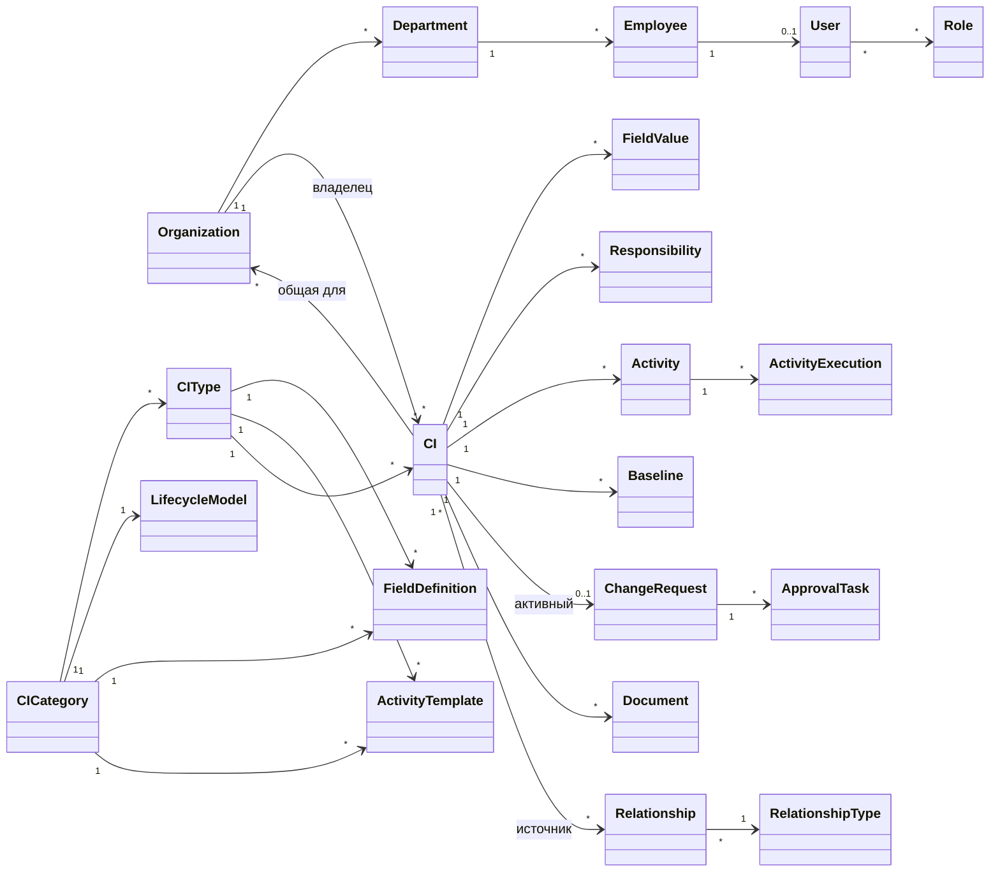
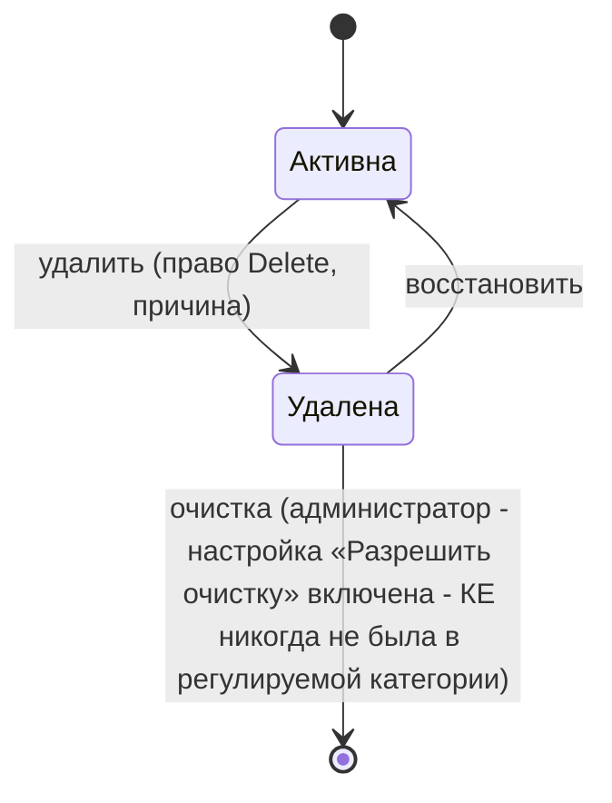
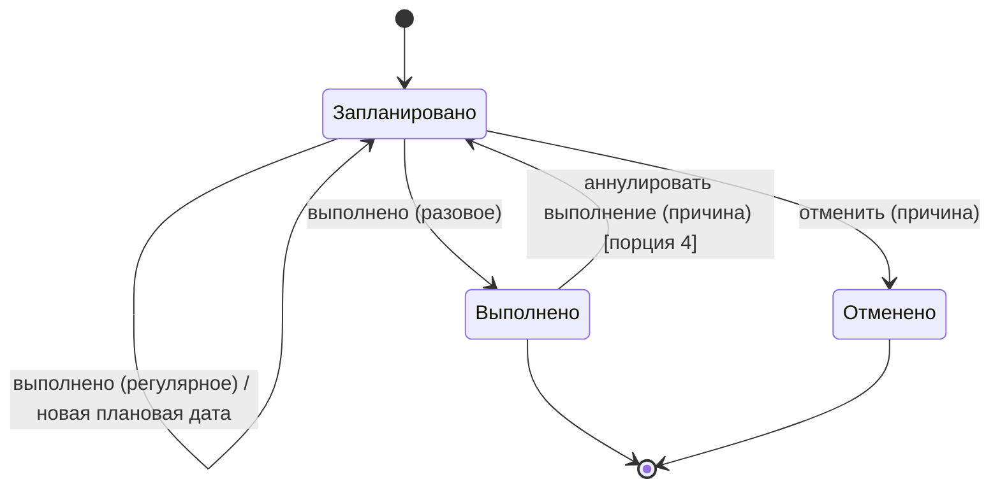
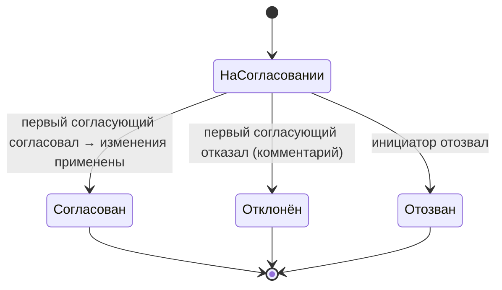
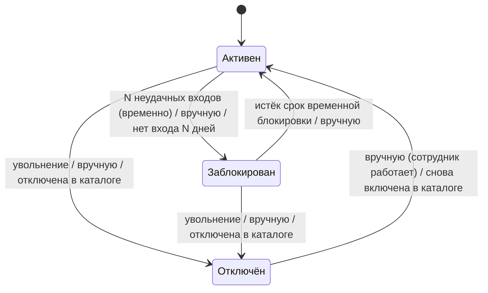

# Доменная модель KE

> Статус: **утверждена ВП** · 2026-10-16 (порция 3) · Аналитик
> Это **логическая** модель: сущности, атрибуты, связи, жизненные циклы и инварианты. Таблицы, индексы и API проектирует Архитектор.
> Термины — по [GLOSSARY.md](GLOSSARY.md). Источники: `[S1 ¶N]` — описание ВП; `[S2]` — записка коллег; `P-n`, `Rn`, `R2-n`, `W-n`, `D-n` — предложения и решения из [discovery.md](discovery.md); `[PO дата]`, `[ревью ВП дата]` — решения ВП вне раундов.
> Типы атрибутов логические: строка, текст, число, дата, дата-время, флаг, ссылка на сущность, запись справочника.

---

## 0. Общая картина

---

## 1. Справочники и перечисления

По решению ВП (комментарий к §5.5 discovery) **любой выбираемый из списка параметр — справочник**. Исключения — перечисления продукта.

**Справочник** — общее понятие, как в 1С [PO 2026-10-10, D-1a]. Все справочники находятся в разделе интерфейса «Справочники». Они бывают двух видов:
- **простые** — список значений с одинаковым набором реквизитов. Заказчик может создавать свои без программиста;
- **встроенные** — со своими реквизитами и логикой продукта: Организации, Подразделения, Сотрудники, Контрагенты, Контактные лица, Типы связей. Их структуру задаёт продукт, наполнение — заказчик.

Право на ведение каждого встроенного справочника и простых справочников — отдельное. Его можно назначить любой роли (D-2a, README §5).

**Простой справочник** (`SimpleDirectory`):

| Атрибут | Тип | Обяз. | Правила |
|---|---|---|---|
| Код | строка | да | латиница, уникален в установке, после создания не меняется |
| Название | строка | да | — |
| Описание | текст | нет | — |
| Иерархический | флаг | да | записи образуют дерево (например, Местоположения) |
| Системный | флаг | да | справочник поставлен продуктом или пакетом. Удалить нельзя, состав записей менять можно |

**Запись справочника** (`DirectoryEntry`):

| Атрибут | Тип | Обяз. | Правила |
|---|---|---|---|
| Справочник | ссылка | да | — |
| Код | строка | да | уникален в справочнике, после создания не меняется |
| Название | строка | да | — |
| Родитель | ссылка на запись | нет | только для иерархических справочников |
| Порядок | число | да | порядок в списках выбора |
| Цвет | цвет | нет | для статусов, критичности и т.п. |
| Действует | флаг | да | недействующую запись нельзя выбрать в новых данных; уже сохранённые значения остаются |
| Системная запись | флаг | да | от записи зависит логика продукта или пакета: переименовать можно, удалить или деактивировать нельзя |

**Простые справочники, которые поставляются с продуктом.** Значения — примеры: заказчик меняет их под себя, кроме системных записей.

| Справочник | Назначение | Как используется | Примеры значений |
|---|---|---|---|
| **Критичность** | Насколько КЕ важна для бизнеса и IT | <ul><li>базовое поле каждой КЕ</li><li>фильтр и сортировка реестра</li><li>колонка в анализе влияния и в блоке «Связанные КЕ» — сразу видно, задето ли критичное</li><li>в roadmap — фильтр рассылки о плановых работах (F-30): «предупреждать только по критичным зависимым КЕ»</li></ul> | Высокая, Средняя, Низкая |
| **Роли ответственности** | Какую ответственность сотрудник несёт за КЕ | <ul><li>матрица ответственности в карточке: роль + сотрудник + основной / замещающий [S2]</li><li>в шаблоне мероприятия: «ответственный по умолчанию — тот, кто в роли X», например периодический пересмотр назначается владельцу системы</li><li>кому слать уведомления о КЕ</li><li>ограничение доступа «только КЕ, где я ответственный» (R8a)</li></ul> | Владелец системы, Владелец процесса, ИТ-сопровождение, Бизнес-владелец |
| **Виды документов** | Что за документ привязан к КЕ | <ul><li>выбирается при прикреплении документа</li><li>фильтр и группировка документов в карточке</li><li>**условия переходов статуса**: «приложен действующий документ вида X» — в GxP-пакете ввод в эксплуатацию требует URS, оценки рисков, протоколов IQ/OQ/PQ и отчёта о валидации (P-27)</li><li>требование вложения нужного вида при выполнении мероприятия</li></ul> | Инструкция пользователя, Матрица прав доступа, URS, Оценка рисков, Протокол IQ / OQ / PQ, Отчёт о валидации, Отчёт об аудите поставщика |
| **Статусы документов** | Действует ли документ | <ul><li>выбирается у документа</li><li>условия переходов статуса учитывают только документы в статусе «Действующий» — отменённый протокол не откроет ввод в эксплуатацию</li><li>фильтр документов</li></ul> | Черновик, **Действующий** (системная запись), Устаревший (заменён новой версией), Отменён (отозван без замены) |
| **Виды мероприятий** | Что за работа планируется по КЕ | <ul><li>выбирается в шаблоне и в мероприятии</li><li>фильтры сквозного реестра и календаря мероприятий: «все поверки в ноябре»</li><li>**условия переходов статуса**: «выполнено мероприятие вида X»</li><li>виджеты и выгрузки для инспекции: «история периодических пересмотров»</li></ul> | Техническое обслуживание, Поверка, Резервное копирование, Периодический пересмотр, Квалификация IQ / OQ / PQ, **Аттестация данных** (системная: её выполнение с ответом «Карточка актуальна» обновляет дату последнего подтверждения актуальности КЕ, P-24, F-23.BR3 [порция 4]), **Разбор итога** (системная: разбор неуспешного итога, F-05.BR20) [порция 4] |
| **Значения подписи** | Что юридически означает электронная подпись (21 CFR Part 11 §11.50 требует указывать смысл подписи) | <ul><li>в настройках ЭП на действии (переход, выполнение мероприятия, согласование, baseline) выбирается значение</li><li>подписант видит его в окне подписи</li><li>значение сохраняется в подписи и показывается в истории и выгрузках: «Иванов И.И., 10.10.2026 14:05, Утверждаю»</li></ul> | Утверждаю, Согласовано, Выполнено, Проверено, Ознакомлен |
| **Причины отмены мероприятия** | Почему запланированное мероприятие не будет выполнено | <ul><li>обязательна при отмене мероприятия, вместе с комментарием</li><li>пишется в историю КЕ</li><li>отчёты: «какие периодические пересмотры отменены и почему» — на инспекции отмена должна быть обоснована</li></ul> | **КЕ выведена из эксплуатации** (системная запись: её подставляет отмена мероприятий при переходе в конечный статус, F-03.BR19), **Выполнение аннулировано** (системная запись: её подставляет отмена разбора итога при аннулировании выполнения, F-05.BR27) [порция 4, PROPOSAL], Заменено другим мероприятием, Создано ошибочно, Прочее |
| **Местоположения** (иерархический) | Где физически находится КЕ | <ul><li>базовое поле КЕ</li><li>фильтр реестра с вложенными уровнями: «всё в корпусе 2»</li><li>из местоположения — переход к списку КЕ в нём [S2]</li><li>в roadmap — основа QR-инвентаризации (F-24)</li></ul> | Площадка «Москва» → Корпус 2 → Этаж 3 → Помещение 214 → Рабочее место 5 |
| **Роли контрагента** | Кем внешняя организация приходится КЕ | <ul><li>в таблице «Внешние контакты» карточки КЕ (§4.6)</li><li>фильтр «все КЕ поставщика X»</li></ul> | Поставщик, Производитель, Подрядчик |
| **Должности** | Единый список должностей сотрудников | <ul><li>реквизит сотрудника</li><li>пополняется при синхронизации с AD и 1С:ЗУП</li><li>фильтр сотрудников</li></ul> | Руководитель службы ИТ, Системный администратор, Инженер по валидации |
| **Системы-источники** | Внешние системы, из которых приходят внешние идентификаторы КЕ | <ul><li>система-источник во внешнем идентификаторе КЕ (§4.1, F-02)</li><li>сопоставление данных API, импорта и будущего мониторинга с КЕ (W-6a)</li></ul> | Zabbix, AD, 1С:Бухгалтерия |

**Справочники GxP-пакета** (discovery §5.5) — поля карточки компьютеризированной системы:

| Справочник | Назначение | Как используется | Значения |
|---|---|---|---|
| **GxP-значимость** | К какой области регулирования относится система | <ul><li>поле карточки</li><li>фильтр реестра: «все GMP-системы» — первое, что просит инспектор (Annex 11 §4.3)</li></ul> | GMP, GDP, GLP, GCP, GVP, Не применимо |
| **Категория GAMP 5** | Тип ПО по GAMP 5; от него зависит объём валидации: для категории 5 (заказное ПО) — полный цикл, для 1 (инфраструктура) — минимум | <ul><li>поле карточки</li><li>фильтр и отчёт</li><li>администратор учитывает её, когда решает, какие мероприятия и документы обязательны для типа</li></ul> | 1, 3, 4, 5 |
| **Влияние** | Оценка влияния системы на безопасность пациента, качество продукта и целостность данных — три поля с этим справочником | <ul><li>поля карточки</li><li>основа для оценки риска</li><li>фильтр</li></ul> | Прямое, Косвенное, Нет |
| **Риск** | Итог регуляторной оценки риска системы. **Не путать с критичностью**: критичность — важность для бизнеса и IT, риск — последствия для пациента, качества и данных. У системы бухгалтерии может быть высокая критичность и низкий GxP-риск | <ul><li>поле карточки</li><li>фильтр и виджеты</li><li>по нему администратор выбирает интервал периодического пересмотра (обычно 12–36 месяцев); автоматического выбора в v1 нет</li></ul> | Высокий, Средний, Низкий |
| **Статус валидации** | Где система находится в цикле валидации (OQ-4: отдельное поле, изменение — контролируемое, с ЭП) | <ul><li>поле карточки</li><li>виджет «распределение по статусам валидации»</li><li>фильтр</li><li>условие перехода «Ввести в эксплуатацию» в GxP-пакете</li></ul> | Не оценивалась, Не требуется, Запланирована, В процессе, **Валидирована**, **Валидирована с ограничениями** (системные записи пакета: на них опирается условие перехода), Требуется ревалидация, Выведена |

**Удаление записей.** Запись справочника, которая где-то используется (в КЕ, документе, шаблоне, настройке или условии перехода), удалить нельзя — только сделать недействующей (INV-23). Полный перечень того, что считается использованием, — F-19.BR15.

Администратор создаёт свои **простые справочники** для настраиваемых полей (P-14).

**Перечисления продукта** — фиксированные списки, новое значение в которых требует кода:
- типы данных полей;
- виды каналов уведомлений;
- виды таск-трекеров;
- статусы мероприятия, запроса на изменение и задания на согласование;
- действия контрольного следа;
- единицы интервала (день, неделя, месяц, год).

Названия значений перечислений переводятся механизмом локализации.

**Встроенные справочники** описаны в своих разделах: Организации (§2.1), Подразделения (§2.2), Сотрудники (§2.3), Контрагенты и Контактные лица (§2.8), Типы связей (§3.6). Настраиваемые поля у встроенных справочников — позже (OQ-1).

---

## 2. Организации и люди

### 2.1 Организация `Organization` [R2-2a]
Код (уникальный, неизменяемый), наименование, ИНН (нет), действует (да).
- Измерение данных: у каждой КЕ есть организация-владелец.
- Конфигурация (категории, типы, справочники, роли) — общая на всю установку.
- Ведущая система сотрудников и оргструктуры организации: вручную / каталог / 1С:ЗУП / API (F-14.BR25).
- Ведение, деактивация, удаление — F-13.BR1, BR2; разделение данных — F-28.

### 2.2 Подразделение `Department`
Организация (да), родитель (нет — дерево), код, наименование, руководитель (сотрудник, нет), внешние идентификаторы (нет; ключ синхронизации с 1С:ЗУП), действует.
- Код уникален в организации; родитель — подразделение той же организации; глубина до 15 уровней (F-13.BR3, BR4).

### 2.3 Сотрудник `Employee` [R7a]
| Атрибут | Тип | Обяз. | Правила |
|---|---|---|---|
| Фамилия, Имя, Отчество | строка | фамилия и имя — да | три поля вместо одного «ФИО»: для вида «Иванов И.И.» в подписях и сортировки (F-13.BR7) |
| Организация | ссылка | да | — |
| Подразделение | ссылка | нет | — |
| Должность | запись простого справочника «Должности» | нет | справочник исключает дубли вида «Зам. руководителя» / «Заместитель руководителя». При синхронизации с AD или 1С:ЗУП должность ищется в справочнике по названию без учёта регистра и пробелов по краям, как в F-19.BR8; если не найдена — добавляется [ревью ВП 2026-10-10] |
| E-mail | строка | нет | формат e-mail; нужен для уведомлений по e-mail |
| Телефон | телефон | нет | проверяется и хранится в едином формате (§3.3, тип «телефон») |
| Telegram | строка | нет | идентификатор для уведомлений; используется, когда появится канал Telegram (F-25) [ревью ВП 2026-10-10] |
| MAX | строка | нет | идентификатор для уведомлений; используется, когда появится канал MAX (F-25) [ревью ВП 2026-10-10] |
| Внешние идентификаторы | список (источник, ID) | нет | AD objectGUID, табельный номер 1С:ЗУП; ключ синхронизации |
| Состояние | перечисление | да | Работает / Уволен. Уволенного нельзя назначить новым ответственным |
| Дата увольнения | дата | при состоянии «Уволен» | F-13.BR10 |
| Табельный номер, дата приёма | строка, дата | нет | табельный номер уникален в организации; ключ загрузки из 1С:ЗУП и файла и связи с каталогом (F-14.BR28) |
| Ведущая система | перечисление | да | Вручную / Каталог / 1С:ЗУП / API. Реквизиты из ведущей системы в интерфейсе только для чтения (F-13.BR9) |

- E-mail, телефон, Telegram и MAX — контактные данные: доступ к ним — INV-28, F-13.BR13 [B3-5d, B3-17a].

### 2.4 Пользователь `User`
| Атрибут | Тип | Обяз. | Правила |
|---|---|---|---|
| Сотрудник | ссылка | да | один сотрудник — не более одной учётной записи |
| Логин | строка | да | уникален в установке без учёта регистра; не переиспользуется (INV-26) |
| Источник аутентификации | перечисление | да | локальная / LDAP-AD / SSO |
| Роли | ссылки | нет | одному пользователю можно назначить несколько ролей [S1 ¶5]. У назначения — происхождение: вручную или из группы каталога (F-14.BR19) |
| Состояние | перечисление | да | Активен / Заблокирован / Отключён |
| Неудачные попытки входа, время блокировки | число, дата-время | — | для блокировки после N неудачных попыток |
| Дата последнего входа | дата-время | — | F-13.BR19, BR20 |
| Пароль (только локальная) | — | — | хранится так, что его нельзя узнать; временный пароль, дата смены, последние пароли (F-14.BR8–BR11) |
| Часовой пояс | строка (часовой пояс) | да | по умолчанию — часовой пояс сервера (A-10) |

### 2.5 Клиент API `ApiClient` [S1 ¶24]
Название, токены (хранятся только хэши; у токена может быть срок действия или, по явному выбору администратора, бессрочный токен), роль, флаг «изменения по API принимаются без согласования» [S1 ¶22] (в регулируемой категории не действует: изменения по API идут через согласование — OQ-5a [PO 2026-10-14]), ответственный сотрудник, состояние.

### 2.6 Роль `Role` [S1 ¶5–6, R8a, P-21]
| Атрибут | Правила |
|---|---|
| Код, название, описание | код неизменяем |
| Доступные разделы | «Главная», «Реестр КЕ», «Мероприятия», «Справочники». «Мои дела» и профиль — у всех; административные экраны открываются правами на действия (F-13.BR23) |
| Права на действия | перечисление действий из матрицы прав README §5 |
| Права по категориям и типам КЕ | для каждого типа: Create / Read / Update / Delete. **Новый тип — права пустые у всех ролей, кроме администратора** [S1 ¶6] |
| Ограничение по записям | организации (список или «все»); «только моё подразделение» — КЕ, у которых подразделение-владелец — моё или вложенное в него [B2-4a]; «только где я ответственный» |
| Права на ведение справочников | отдельное право на каждый встроенный и каждый простой справочник (D-2a, B2-7a) |
| Видит историю КЕ | отдельное право [S1 ¶5] |
| Системная | роль «Администратор системы» нельзя удалить и лишить прав. Её права — все, кроме права на контактные данные |
| Роль «Ответственный по работе с ПД» | поставляется продуктом, удалить нельзя; единственное её право — «Просмотр и ведение контактных данных», в другие роли оно не включается (F-13.BR13) [B3-5d] |

**Новые роли**: администратор системы создаёт роли с любой комбинацией атрибутов выше, меняет и удаляет их, в том числе роли по умолчанию (README §5).

**Сложение ролей**: у пользователя действует объединение прав всех его ролей, «разрешение побеждает запрет» [S1 ¶5]. Ограничения по записям тоже объединяются: КЕ видна, если её разрешает хотя бы одна роль. Уточнение: право на тип и ограничение по записям сочетаются внутри одной роли: действие над КЕ разрешено, если хотя бы одна роль даёт право на её тип и её же ограничение пропускает КЕ (F-13.BR26).

### 2.7 Замещение `Substitution` [P-2]
Кого замещают, кто замещает, период (с, по), область (согласование изменений и подтверждение мероприятий — одно замещение на оба вида [B4-4, порция 4]; в будущем другие полномочия), комментарий. Действия заместителя пишутся в контрольный след «от имени». Кто создаёт, ограничения и действие — F-13.BR44–BR47. Руководитель сотрудника — руководитель его подразделения или ближайшего вышестоящего (F-13.BR51) [B4-4, порция 4].

### 2.8 Контрагент `Counterparty` и Контактное лицо `Contact` [S2, R13a]
- **Контрагент** — встроенный справочник. Атрибуты: код (неизменяемый), наименование, ИНН (нет), действует.
- **Контактное лицо** — встроенный справочник. Атрибуты: контрагент (обязательно), ФИО, должность (строка), телефон (тип «телефон»), e-mail, действует. Телефон и e-mail — контактные данные (INV-28, F-19.BR22).
- **Внешние контакты КЕ** (§4.6) ссылаются на контрагентов и их контактных лиц.

---

## 3. Конфигурация КЕ

### 3.1 Категория КЕ `CICategory` [R1a]
| Атрибут | Правила |
|---|---|
| Код | латиница, уникален среди категорий; после создания не меняется — на него ссылаются API, импорт и пакеты конфигурации |
| Название | обязательно, уникально среди категорий; можно менять |
| Описание | необязательно; подсказка администраторам и пользователям, для чего категория |
| Иконка | необязательна; выбирается из встроенного набора; показывается в реестре, карточке и графе связей |
| Настраиваемые поля категории | наследуются всеми типами категории |
| Статусная модель | одна на категорию (§3.5) |
| Шаблоны мероприятий | создаются у каждой КЕ всех типов категории |
| Контроль изменений | включён / выключен; роль-согласующий; контролируемые поля и переходы помечаются на самих полях и переходах |
| Регулируемая | при включении: обязательная причина изменения (P-5), запрет очистки (R6a). Термин не привязан к фарме — см. глоссарий [PO 2026-10-09] |
| Ссылки и документы | P-11 |

### 3.2 Тип КЕ `CIType` [S1 ¶6–10]
| Атрибут | Правила |
|---|---|
| Категория | обязательна; после появления КЕ не меняется |
| Код | латиница, уникален среди типов всей установки; после создания не меняется |
| Название | обязательно, уникально внутри категории; можно менять |
| Описание | необязательно; для чего тип |
| Иконка | необязательна; если не задана — иконка категории |
| Настраиваемые поля типа | добавляются к полям категории |
| Шаблон карточки | порядок и группировка полей категории и типа, элементы оформления |
| Ответственные типа | список сотрудников-подсказок при выборе ответственных; флаг «только указанные ответственные» [S1 ¶10] |
| Шаблон кода КЕ | необязателен: префикс и число цифр порядкового номера, например «SRV-» и 6 цифр → «SRV-000124» (F-01.BR12) [B2-2a] |
| Шаблоны мероприятий типа | добавляются к шаблонам категории [S1 ¶13] |
| Ссылки и документы | P-11 |
| Действует | недействующий тип нельзя выбрать для новых КЕ. Деактивация запрещена, пока есть КЕ этого типа в статусах, кроме конечных [S2] |

### 3.3 Определение поля `FieldDefinition` [S1 ¶7–9, P-6, P-8, P-12]
| Атрибут | Правила |
|---|---|
| Владелец | категория или тип |
| Код | латиница; задаётся при создании (предлагается из названия); после сохранения **не меняется**. Уникален в пределах категории вместе со всеми её типами |
| Название, подсказка | меняются свободно |
| Тип данных | перечисление: строка, текст, число (целое или дробное; единица, мин., макс., точность), дата, дата-время, флаг, значение справочника (одно или несколько), сотрудник, контрагент, местоположение, URL, e-mail, **телефон**. **После появления данных не меняется** |
| Обязательное | можно включить в любой момент, см. INV-6 |
| Значение по умолчанию | — |
| Проверка | маска (регулярное выражение) для строк; диапазон для чисел и дат |
| Тип «телефон» | номер проверяется при вводе и хранится в международном формате. Российские номера, введённые с «8» или «+7», приводятся к «+7». При вводе цифры группируются: «+7 (912) 333-22-22». Номера других стран вводятся с кодом страны [ревью ВП 2026-10-10] |
| Уникальное в типе | например, серийный номер |
| Контролируемое | изменение требует согласования при включённом контроле изменений категории (P-3) |
| Контролируемая дата | только для дат: уведомления за N дней (до трёх сроков) и подсветка (P-8) |
| Только для чтения в интерфейсе | заполняется через API или импорт |
| Архивировано | P-6 |

**Базовые поля** (P-13) есть у каждой КЕ, удалить их нельзя:
- Код, Наименование, Тип, Статус, Критичность;
- Организация-владелец и «Общая для организаций»;
- Подразделение-владелец [B2-4a];
- Местоположение, Описание;
- Ответственные (матрица);
- Дата ввода в эксплуатацию, Дата вывода из эксплуатации;
- служебные: создана (кем, когда), изменена (кем, когда), дата последнего подтверждения актуальности (P-24).

### 3.4 Элемент оформления `LayoutElement` [S1 ¶7]
Группа полей (заголовок, сворачиваемая), разделитель, текстовый блок (подсказка). Удаляется в любой момент [S1 ¶9].

### 3.5 Статусная модель `LifecycleModel` [R2a, P-1]
- **Статус**: код (неизменяемый), название, цвет, признаки:
  - начальный — ровно один на модель;
  - эксплуатационный — по таким КЕ считаются мероприятия и уведомления;
  - конечный — например, «Выведена из эксплуатации», «Списана».
- **Переход** (`Transition`):
  - из статуса, в статус, название действия;
  - роли, которым разрешён;
  - **условия**: заполнены указанные поля; значение поля — одна из указанных записей справочника (OQ-4); выполнены мероприятия указанных видов, при необходимости не старше N дней; приложены документы указанных видов (P-27). Подробно — F-03.BR11;
  - контролируемый — требует согласования (P-3);
  - требует ЭП со значением подписи;
  - что заполняется при переходе: например, дата ввода в эксплуатацию.

Пример модели «Базового ИТ-пакета» (настраивается): Планируется → Внедрение → В эксплуатации ⇄ На обслуживании → Выведена из эксплуатации → Списана.

Мягкое удаление — не статус, а отдельный признак КЕ (§4.1).

### 3.6 Тип связи `RelationshipType` [S1 ¶16, P-7, W-3c]
| Атрибут | Правила |
|---|---|
| Код | неизменяем |
| Прямое название, обратное название | «Входит в» / «Включает в себя». Для симметричного типа названия совпадают («Взаимодействует с») |
| Описание | необязательно: когда использовать тип |
| Направление влияния | источник зависит от цели / цель зависит от источника / взаимная зависимость / нет зависимости (F-04.BR3) [ревью ВП 2026-10-14] |
| Допустимые пары | список (категория или тип источника, категория или тип цели). Пустой список — любые пары |
| Симметричный | связь одинаково читается с обеих сторон; направление влияния — только «взаимная зависимость» или «нет зависимости»; связь B → A считается той же, что A → B (F-04.BR2) |
| Иерархический | для таких типов запрещены циклы |
| Действует | недействующий тип нельзя выбрать для новых связей; существующие остаются (F-04.BR8) |

### 3.7 Шаблон мероприятия `ActivityTemplate` [S1 ¶11–13, R9a, P-9, P-29]
| Атрибут | Правила |
|---|---|
| Владелец | категория или тип |
| Название, вид мероприятия | вид — запись справочника |
| Регулярное / разовое | — |
| Интервал | число и единица (день, неделя, месяц, год); отсчёт — от фактической или от плановой даты (R9a) |
| Обязательное | у каждой КЕ этого типа обязательно должно быть такое мероприятие [S1 ¶13]. Обязательный шаблон сам создаёт мероприятие у КЕ; необязательный добавляют из карточки (F-05.BR2) [B4-1a, порция 4] |
| Ответственный по умолчанию | роль ответственности из матрицы КЕ (например, «Владелец системы»). Мероприятие следует за матрицей: ответственный — текущий основной сотрудник роли (F-05.BR8) [B4-3a, порция 4] |
| Результат обязателен | [S1 ¶11] |
| Требуется ЭП | со значением подписи [S1 ¶11] |
| Требуется вложение | — |
| Уведомления | список правил: каналы, за сколько дней (до трёх сроков) [S1 ¶11], получатели, дополнительный текст; эскалация просрочки (F-06.BR8–BR10) [порция 4] |
| Задачи в трекере | список правил: подключение, **исполнитель — пользователь таск-трекера** (выбирается из списка пользователей трекера через подключение, потому что пользователи KE и трекера не совпадают один к одному), за сколько дней, шаблон текста со ссылкой на КЕ [S1 ¶11, ревью ВП 2026-10-10]. Ещё два режима исполнителя — «ответственный мероприятия» и «без исполнителя» (F-07.BR5) [B4-12a, порция 4] |
| Чек-лист | пункты: текст, обязательный, тип ответа — отметка / значение (единица, допуск) / файл |
| Реакция на итог [порция 4] | для «С замечаниями» и «Неуспешно»: нет / уведомить / уведомить и создать разбор; срок разбора — дней, по умолчанию 5; роли ответственности — получатели (F-05.BR19, BR20) [B4-6a] |
| Предупреждать зависимых КЕ [порция 4] | roadmap: флажок, глубина, фильтр критичности, роли (F-30) [W-5a] |

Изменение шаблона не меняет мероприятия, уже созданные у КЕ. Администратор может применить изменение к существующим мероприятиям массово (P-9).

---

## 4. КЕ и её данные

### 4.1 КЕ `ConfigurationItem`
| Атрибут | Правила |
|---|---|
| Системный ID | неизменяемый, назначается системой |
| Код | **уникален в установке**, ключ для API и импорта [S2, P-12]. Проверка дублей при создании — INV-9. Формат, шаблон кода и изменение кода — F-02.BR21, BR32 |
| Наименование | по умолчанию — название типа [S2] |
| Тип | категория определяется через тип. Тип можно сменить только на другой тип той же категории (F-02.BR31) [B2-5a] |
| Статус | из статусной модели категории; при создании в интерфейсе — начальный. Через импорт и API новую КЕ можно создать в любом статусе модели (F-03.BR21) [B2-6a] |
| Критичность, Местоположение, Описание | базовые поля |
| Организация-владелец | обязательна [R2-2a] |
| Подразделение-владелец | необязательно; подразделение организации-владельца; по умолчанию — подразделение автора. На нём работает ограничение роли «только моё подразделение» (F-02.BR33) [B2-4a] |
| Общая для организаций | список; КЕ видна пользователям этих организаций по правилам ролей. Что даёт такой доступ — настройка «Доступ к общим КЕ» (F-28.BR5) |
| Значения полей | по шаблону типа |
| Удалена (мягко) | флаг; кто, когда, причина [R6a] |
| Есть изменения на согласовании | вычисляется по активному запросу на изменение |
| Неполная | вычисляется: не заполнены обязательные поля (INV-6, P-23) |
| Дата последнего подтверждения актуальности [порция 4] | базовое служебное поле (§3.3), только для чтения; обновляется ответом аттестации «Карточка актуальна» (F-23.BR3) [B4-14a] |
| Требует правки [порция 4] | пометка, комментарий, кто, когда; ставит ответ аттестации «Нужны правки» (F-23.BR4) [B4-14a] |
| Внешние идентификаторы | список (система-источник, значение); пара уникальна в установке. Для API, импорта и будущего мониторинга (W-6a). Система-источник — запись справочника «Системы-источники» |
| Оперативное состояние | зарезервировано: норма / предупреждение / авария / нет данных. Заполняется с интеграцией мониторинга (roadmap, W-6a) |

### 4.2 Ответственность `Responsibility` [P-10, S2]
КЕ, роль ответственности, сотрудник, основной / замещающий. На одну роль ответственности — не больше одного основного.

### 4.3 Связь `Relationship` [S1 ¶16, P-7, W-3c]
Источник, цель, тип связи, комментарий, кто и когда создал. **Весов у связей нет** (решение ВП W-3c).
- Хранится **одна** запись.
- В карточке источника она показывается под прямым названием типа, в карточке цели — под обратным.

### 4.4 Документ `Document` [S1 ¶18, P-11]
Вид документа, название, файл **или** ссылка (ровно одно из двух), версия, дата, статус документа (справочник «Статусы документов»), связи с КЕ и типами КЕ (многие ко многим), кто загрузил, контрольная сумма файла.

### 4.5 Baseline `Baseline` [S1 ¶17, R10a, P-15]
КЕ, номер версии (1, 2, …), снимок значений всех полей и статуса КЕ на момент создания (связи — в следующей версии, OQ-2), причина, кто и когда создал, ЭП (если требуется), признак «текущий». Версии не изменяются и не удаляются.

### 4.6 Внешний контакт КЕ `ExternalContact` [S2, R13a]
Таблица в карточке КЕ:
- роль контрагента — простой справочник «Роли контрагента»: Поставщик, Производитель, Подрядчик;
- контрагент;
- контактное лицо — выбирается только из контактов этого контрагента;
- примечание.

---

## 5. Мероприятия

### 5.1 Мероприятие `Activity` [S1 ¶11–15]
| Атрибут | Правила |
|---|---|
| КЕ, шаблон | шаблон пуст для мероприятий, созданных вручную |
| Название, вид, регулярное / разовое | — |
| Ответственный | сотрудник; выбирается из матрицы ответственности, ответственных типа или поиском — с учётом флага «только указанные» [S1 ¶10]. Задаётся ролью ответственности (следует за матрицей) или вручную (F-05.BR8) [B4-3a, порция 4] |
| Подтверждающий [порция 4] | пользователь, необязательно: может подтвердить вместо ответственного (F-05.BR9) [B4-4] |
| Плановая дата | для нового мероприятия — сегодня или позже [S1 ¶11]; дата, рассчитанная от введённой даты последнего выполнения, может быть в прошлом (INV-19, F-05.BR10) [порция 4, PROPOSAL]. У мероприятия из обязательного шаблона пуста, пока КЕ ни разу не была в эксплуатационном статусе (F-05.BR4) [B4-2a, порция 4] |
| Дата последнего выполнения | для регулярного мероприятия; пуста, если ещё не выполнялось |
| Интервал и отсчёт | для регулярного мероприятия; если интервал задан, плановая дата считается автоматически [S1 ¶11] |
| Настройки | результат обязателен, ЭП, вложение, уведомления, задачи, чек-лист, реакция на итог, предупреждение зависимых КЕ (F-30) — копируются из шаблона и редактируются. Требования мероприятия из обязательного шаблона не ослабляются (F-05.BR5) [порция 4] |
| Разбор [порция 4] | для мероприятия «Разбор итога» — ссылка на выполнение, которое разбирают (F-05.BR20) |
| Массовая операция [порция 4] | номер массовой операции, которой создано мероприятие; по нему строится отчёт кампании аттестации (F-23.BR6) [PROPOSAL] |
| Состояние | перечисление: Запланировано / Выполнено (только разовое) / Отменено (с причиной) |
| Статус срока | вычисляется: просрочено / близкий срок / в норме [S1 ¶15] |

### 5.2 Выполнение мероприятия `ActivityExecution` [S1 ¶12]
Мероприятие, плановая дата, фактическая дата (по умолчанию — плановая; изменить можно, расхождение пишется в историю), результат, ответы чек-листа, вложения, ЭП, исполнитель (пользователь), рассчитанная следующая дата и способ её задания («через X» или вручную; смена способа пишется в историю).

[порция 4] Добавлены: итог — «Успешно», «С замечаниями», «Неуспешно» (F-05.BR18) [B4-6a]; «за кого» — если подтвердил не ответственный и не подтверждающий: заместитель, руководитель или пользователь с правом «Подтверждение любых мероприятий» (F-05.BR15); опоздание в днях; аннулирование — кто, когда, причина, подпись (F-05.BR26) [B4-5a]. Выполнение не редактируется.

### 5.3 Связанная задача `LinkedTask` [S1 ¶11, R11a]
Мероприятие, подключение к трекеру, ключ задачи, ссылка, последний известный статус, время синхронизации. **Закрытие задачи в трекере не выполняет мероприятие** (R11a). [порция 4] Наблюдатели; состояние создания — создана или ошибка с текстом (F-07.BR6, BR11).

---

## 6. Контроль изменений и подпись

### 6.1 Запрос на изменение `ChangeRequest` [S1 ¶22–23, R3a, R4a, R2-1a, P-2–P-4]
| Атрибут | Правила |
|---|---|
| КЕ | — |
| Инициатор | пользователь или клиент API |
| Предлагаемые изменения | список «поле: было → станет» и/или переход статуса |
| Причина | обязательна для регулируемой категории |
| Роль-согласующий | из настроек категории на момент создания |
| Состояние | На согласовании / Согласован / Отклонён / Отозван инициатором |
| Решение | кто, когда, комментарий (при отказе обязателен), ЭП (если требуется) |

### 6.2 Задание на согласование `ApprovalTask`
Запрос, согласующий (пользователь роли или его заместитель), состояние: Активно / Выполнено / **Неактуально** (решение принял другой участник — P-2, R2-1a).

### 6.3 Электронная подпись `ESignature` [R5a]
Подписант (пользователь), время (сервер), значение подписи, подписываемый объект и его версия (контрольная сумма подписываемых данных), действие, способ повторной аутентификации. Подпись показывается в карточке, истории и выгрузках: ФИО, дата-время, значение.

---

## 7. Контрольный след, уведомления, интеграции

### 7.1 Запись контрольного следа `AuditRecord` [S1 ¶5, ¶20, P-16]
| Атрибут | Правила |
|---|---|
| Порядковый номер | монотонно растёт, без пропусков |
| Время | серверное, синхронизированное |
| Кто | пользователь / клиент API / система; «от имени» при замещении |
| Действие | перечисление: создание, изменение (с результатом «было → стало»), мягкое удаление, восстановление, очистка, переход, согласование, отказ, подпись, вход, неудачный вход, выход, изменение прав, изменение конфигурации, экспорт, импорт и др. Записи краткие, но по каждой полностью понятно, кто, когда и что сделал [ревью ВП 2026-10-10] |
| Объект | тип и ID; КЕ, если относится к КЕ |
| Изменения | список «поле: было → станет» |
| Причина изменения | если вводилась |
| Источник запроса | IP-адрес, интерфейс / API |
| Хэш предыдущей записи, хэш записи | цепочка для обнаружения правок (P-16) |

### 7.2 Уведомление `Notification` [S1 ¶21, R11a]
Получатель (сотрудник или групповой чат канала-вебхука [порция 4]), канал, событие, текст, состояние доставки (В очереди / Отправлено / Ошибка после N попыток / Нет адреса получателя [порция 4]), число попыток, время. Для колокольчика — прочитано или нет. Напоминания о сроках по e-mail собираются в ежедневную сводку (F-06.BR15) [B4-9c, порция 4].
- Если у получателя нет адреса для канала (нет e-mail), уведомление по этому каналу не отправляется и помечается «Нет адреса получателя» [S1 ¶21].

### 7.3 Канал уведомлений `NotificationChannel`
Вид (перечисление), параметры подключения (секреты хранятся отдельно и не попадают в пакеты конфигурации — P-19), число повторов и пауза [S1 ¶21], действует. [порция 4] У вебхука — пресет («Универсальный» или «Битрикс24») и «Передавать e-mail получателя» (F-06.BR3, BR4) [B4-10b].

### 7.4 Подключение к таск-трекеру `TrackerConnection`
Вид (Яндекс Трекер, Jira Cloud, Jira Server/Data Center, универсальный коннектор [B4-11c, порция 4]), адрес, учётные данные (секрет), очередь или проект по умолчанию, сопоставление полей, статус закрытия, «Искать пользователей по e-mail» (F-07.BR2, BR5, BR9) [B4-13a, порция 4].

### 7.5 Событие мониторинга `MonitoringEvent` (roadmap, задел — W-6a)
Источник, внешний ключ объекта, тип и важность события, время, данные события, сопоставленная КЕ (по внешним идентификаторам) или пометка «не сопоставлено».
- Хранится отдельно от контрольного следа, со своим сроком хранения.
- Сущность описана, чтобы архитектура её учла. В v1 не реализуется.

### 7.6 Подключения для входа и синхронизации
- **Подключение к каталогу** `LdapConnection` — AD или LDAP v3-каталог: серверы, шифрование, служебная учётная запись (секрет), базовый DN и фильтр, домен, правило выбора организации, сопоставление атрибутов, расписание, порог отключения (F-14.BR14–BR20). Код не `Directory…`: так называется справочник.
- **Сопоставление группы и роли** `GroupRoleMapping` — подключение, DN группы, роли KE (F-14.BR19).
- **Провайдер SSO** `SsoProvider` — протокол, адрес, идентификатор клиента, секрет, утверждение с логином (F-14.BR23).
- **Подключение к 1С:ЗУП** `HrConnection` — адрес, учётная запись (секрет), сопоставление организаций, расписание, порог отключения (F-14.BR26, BR27).
- **Журнал синхронизаций** `SyncRun` — время, подключение, счётчики, ошибки по строкам; хранится 365 дней (F-14.BR21).

---

## 8. Конфигурация продукта и настройки

- **Пакет конфигурации** `ConfigPackage` [S1 ¶4, P-19]: версия формата, версия продукта, манифест (что включено), содержимое, контрольная сумма, кто и когда выгрузил. **Журнал импорта**: режим (в чистую систему / слияние), результат предварительного просмотра, применённые изменения.
- **Настройки системы**:
  - порог «близкий срок» в днях [S1 ¶15];
  - через сколько дней скрывать выполненные и отменённые разовые мероприятия [S1 ¶14] — по умолчанию 30 (F-05.BR12) [порция 4];
  - «Повтор напоминания о просрочке» — по умолчанию 7 дней; «Время сводки» — по умолчанию 09:00 (F-06.BR9, BR15) [порция 4];
  - внешний адрес установки — для ссылок в уведомлениях и QR-кодах (F-24.BR2) [порция 4];
  - наборы параметров печати QR-наклеек (F-24.BR1) [порция 4, PROPOSAL];
  - порог «устаревшая КЕ» (P-28);
  - анализ влияния: глубина по умолчанию 3, максимум 5 (W-4a);
  - блок «Связанные КЕ»: глубина по умолчанию 1; окно недавних изменений и окно плановых работ — по умолчанию 14 дней (W-2a, W-5a);
  - «Разрешить очистку» — по умолчанию выключено [PO 2026-10-09];
  - «Минимум участников роли-согласующего» — 1–10, по умолчанию 1 (INV-15) [B3-19];
  - «Доступ к общим КЕ» — «Только просмотр» (по умолчанию) или «По правам роли» (F-28.BR5) [B3-1c];
  - «Видимость сотрудников других организаций» — «Все организации» (по умолчанию) или «Только свои организации» (F-28.BR12) [B3-4c];
  - «Допустимые схемы URL» — для полей типа URL, по умолчанию `http://` и `https://`; `javascript:`, `data:`, `vbscript:` запрещены всегда (F-01.BR18) [ревью ВП 2026-10-12];
  - политика паролей, тайм-аут сессии, число неудачных входов до блокировки;
  - длительность временной блокировки, наибольшая длительность сессии, срок временного пароля (F-14.BR4, BR5, BR11); «Блокировать учётные записи без входа N дней» — по умолчанию выключено (F-13.BR20);
  - оформление: логотип, основные цвета [S1 ¶26].
- **Сохранённое представление** `SavedView` [S1 ¶25]: владелец, название, личное или общее, фильтры, колонки, сортировка. Последние фильтры пользователя запоминаются автоматически. Общее представление публикует пользователь с правом «Публикация общих представлений» (F-02.BR9).

---

## 9. Жизненные циклы

### 9.1 КЕ: мягкое удаление (независимо от статуса)

### 9.2 Мероприятие

Статус срока («просрочено», «близкий срок») вычисляется у мероприятий в состоянии «Запланировано» и только для КЕ в эксплуатационных статусах, не удалённых. [порция 4] Мероприятие из обязательного шаблона без плановой даты «ждёт ввода в эксплуатацию» (F-05.BR4). Выполнение засчитывается с любым итогом (F-05.BR18). У регулярного мероприятия аннулирование возвращает прежние плановую дату и дату последнего выполнения (F-05.BR27).

### 9.3 Запрос на изменение и задания

Когда запрос выходит из состояния «На согласовании», все его активные задания становятся «Неактуально». Их владельцы получают уведомление о результате, а действия «Согласовать» и «Отказать» им недоступны (P-2, R2-1a).

### 9.4 Пользователь
Активен ⇄ Заблокирован (N неудачных входов или вручную) → Отключён (сотрудник уволен или учётная запись отключена вручную).

 Уточнение (F-13.BR15):

Учётная запись не удаляется (INV-26).

### 9.5 Доставка уведомления
В очереди → Отправлено | Ошибка (после N попыток с паузой) | Нет адреса получателя.

---

## 10. Инварианты

| № | Правило | Источник |
|---|---|---|
| INV-1 | Код КЕ уникален в установке. Коды категорий, типов КЕ, полей, справочников и их записей, статусов, типов связей, ролей, организаций, подразделений и контрагентов после создания не меняются | S2, P-12 |
| INV-2 | Базовые поля удалить нельзя | S1 ¶7 |
| INV-3 | Настраиваемое поле можно удалить, только пока нет ни одной КЕ (в том числе мягко удалённой) его категории или типа. Иначе — только архивировать. Если у категории или типа уже есть КЕ, пользователь видит предупреждение при открытии шаблона на редактирование и при попытке удалить настраиваемое поле. Для каждого вида предупреждения можно поставить флажок «Больше не предупреждать» — он действует для этого пользователя | S1 ¶9, P-6, ревью ВП 2026-10-10 |
| INV-4 | Элементы оформления удаляются в любой момент | S1 ¶9 |
| INV-5 | Тип данных поля после появления данных не меняется. При попытке сменить тип пользователь видит сообщение с причиной | P-6, ревью ВП 2026-10-10 |
| INV-6 | Добавление обязательного поля или включение обязательности не ломает существующие КЕ: они становятся «неполными», а при следующем сохранении карточки интерфейс требует заполнить поле | S1 ¶7 |
| INV-7 | Новый тип КЕ получает пустые права у всех ролей, кроме администратора | S1 ¶6 |
| INV-8 | Права ролей пользователя объединяются, разрешение побеждает запрет. Право на тип КЕ объединяется вместе с ограничением по записям той же роли (F-13.BR26) | S1 ¶5 |
| INV-9 | При создании КЕ система предупреждает о возможном дубле: тот же тип и совпадение Наименования. Совпадение поля, отмеченного «уникальное в типе», — не предупреждение, а запрет: такая КЕ не сохраняется (F-01.BR23) [B2-3a] | P-12 |
| INV-10 | Связь КЕ сама с собой запрещена. Пара «источник, цель, тип» уникальна. Пара категорий и типов должна быть допустимой для типа связи — это проверяется при создании связи; связи, созданные до изменения допустимых пар или до смены типа КЕ, остаются и помечаются (F-04.BR5). В иерархических типах циклы недопустимы | P-7 |
| INV-11 | ~~Вес связи~~ — снято: весов у связей нет | W-3c |
| INV-12 | У КЕ не больше одного активного запроса на изменение | P-4 |
| INV-13 | Инициатор не может согласовать собственный запрос, даже если состоит в роли-согласующем | P-2 |
| INV-14 | Решение по запросу принимается один раз: первое решение окончательное | R2-1a |
| INV-15 | **Запрос на изменение не остаётся без согласующего, кроме инициатора.** [переработан: B3-19, ВП 2026-10-15; было — «не меньше двух участников» по ревью ВП 2026-10-10] <ul><li>настройка системы «Минимум участников роли-согласующего» — от 1 до 10, по умолчанию 1. Подсказка в настройках объясняет, зачем больше одного: если единственный согласующий недоступен и замещающий не назначен (F-13.BR44), запросы ждут. Назначить замещающего на время отсутствия — задача организации</li><li>контроль изменений нельзя включить, если в роли-согласующем меньше активных участников, чем этот минимум</li><li>ручное изменение (исключение из роли, блокировка, отключение, увольнение), после которого участников станет меньше минимума, система не даёт сохранить и объясняет почему</li><li>если участник выбыл автоматически (синхронизация, загрузка, блокировка без входа), изменение выполняется, а администраторы системы получают уведомление</li><li>если минимум увеличили, а в роли меньше участников, контроль изменений не выключается: категория помечается в настройках, администраторы системы получают уведомление</li><li>запрос, у которого нет согласующих, кроме инициатора, — например, единственный участник роли сам его создал, — передаётся администраторам системы, кроме самого инициатора [B3-18a]</li></ul> | R4a, B3-19 |
| INV-16 | Записи контрольного следа не изменяются и не удаляются никем, включая администратора | S1 ¶20 |
| INV-17 | Версии baseline не изменяются и не удаляются. Единственное исключение — очистка КЕ (INV-18): версии удаляются вместе с КЕ (F-03.BR27) | R10a |
| INV-18 | Очистка возможна, только если включена настройка системы «Разрешить очистку» (по умолчанию выключена), и никогда — в регулируемой категории. КЕ, которая хотя бы раз была в регулируемой категории, очистить нельзя и после выключения признака (F-03.BR27) | R6a, [PO 2026-10-09] |
| INV-19 | Плановая дата нового мероприятия — сегодня или позже. Фактическая дата выполнения — не позже текущей. [порция 4, PROPOSAL] Ограничение действует на дату, введённую вручную; дата, рассчитанная от введённой даты последнего выполнения, может быть в прошлом — тогда мероприятие сразу просрочено (F-05.BR10) | S1 ¶11 |
| INV-20 | Подтвердить выполнение мероприятия может только пользователь с правом «Подтверждение мероприятия, где пользователь — ответственный, подтверждающий, их заместитель или руководитель», который приходится мероприятию ответственным, подтверждающим, их заместителем на время замещения или руководителем, у которого они в подчинённых (F-13.BR51), либо пользователь с правом «Подтверждение любых мероприятий» (по умолчанию — администратор) (F-05.BR15). Тот же круг и автор выполнения аннулируют выполнение (F-05.BR26) [B4-4, B4-5a, порция 4] | S1 ¶12, R7a |
| INV-21 | Секреты (пароли, токены) никогда не попадают в пакеты конфигурации, выгрузки и контрольный след | P-19 |
| INV-22 | Системные записи справочников нельзя удалить или деактивировать | §1 |
| INV-23 | Используемую запись справочника нельзя удалить, только сделать недействующей. Сохранённые значения при этом остаются | §1 |
| INV-24 | Формат кода категории, типа КЕ, поля, справочника и записи, статуса, типа связи, роли, организации, подразделения, контрагента: строчные латинские буквы, цифры и «_», первый символ — буква, длина 1–64. Система предлагает код из названия транслитерацией. У кода КЕ свои правила (F-02.BR21) | P-12 |
| INV-25 | В установке всегда есть хотя бы одна активная локальная учётная запись с системной ролью «Администратор системы» (F-14.BR13) | ВП 2026-10-16 (порция 3) |
| INV-26 | Учётная запись пользователя не удаляется; логин не переиспользуется для другого сотрудника (F-13.BR16) | NFR-9, 21 CFR Part 11 §11.300(a) |
| INV-27 | Системную роль «Администратор системы» назначает и снимает только пользователь, у которого она есть (F-13.BR30) | ВП 2026-10-16 (порция 3) |
| INV-28 | Контактные данные сотрудников и контактных лиц видит и ведёт только пользователь с ролью «Ответственный по работе с ПД», в том числе в контрольном следе, выгрузках и API; администратор системы без этой роли их не видит. Исключения: свои контактные данные пользователь видит всегда, свои Telegram и MAX меняет в профиле; синхронизация записывает контактные данные из ведущей системы (F-13.BR13) | B3-5d, B3-17a |

---

## 11. Открытые вопросы к модели

- **OQ-1.** ~~Нужны ли настраиваемые поля у Сотрудников, Контрагентов и Местоположений?~~ **Решено [PO 2026-10-09]:** не в v1, позже.
- **OQ-2.** ~~Входят ли связи и мероприятия в снимок baseline?~~ **Решено [PO 2026-10-09]:** в v1 baseline — значения полей и статус. Связи — в следующей версии.
- **OQ-3** (Архитектору). Как подписывают пользователи SSO, у которых нет пароля в KE? Варианты: повторный вход через SSO, отдельный PIN подписи, пароль LDAP.
- **OQ-5.** ~~Действует ли флаг клиента API «изменения принимаются без согласования» в регулируемой категории?~~ **Решено [PO 2026-10-14]: вариант a** — не действует. В регулируемой категории изменения контролируемых полей и контролируемые переходы, пришедшие через API, идут через согласование так же, как из интерфейса. В нерегулируемой категории флаг действует. Учесть в F-08 и F-15.
